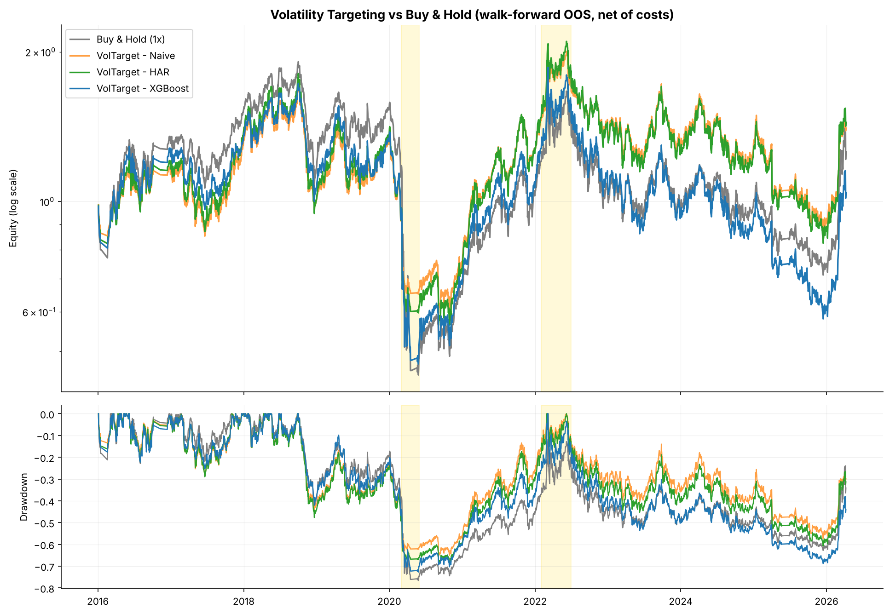
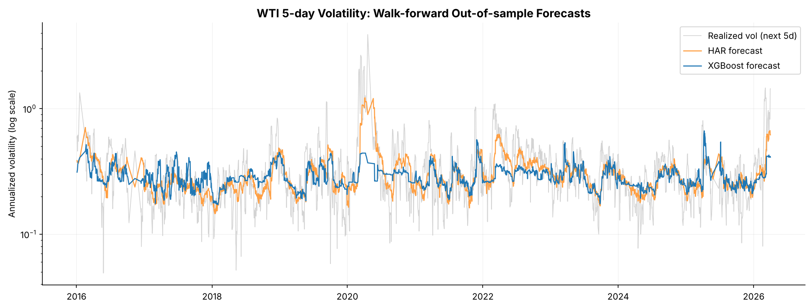

# WTI Crude Oil: Return vs. Volatility Predictability

Can machine learning predict WTI crude oil? This project tests two targets on 20 years of daily data (2006–2026) with
macro (DXY, VIX) and EIA inventory features:

| Target | Out-of-sample result | Verdict |
|---|---|---|
| 5-day **return** (XGBoost, test 2024–2026) | Rank IC −0.07; long-short −44% vs. buy-and-hold +41% | No exploitable edge |
| 5-day **realized volatility** (5 models, walk-forward 2016–2026) | Rank IC 0.40–0.46; R² up to 0.25 | Predictable, and useful for position sizing |

Simple models hold their own here. Random Forest has the lowest error, but the 3-feature HAR model is a very close
second, and the best risk-adjusted overlay is built on HAR, not XGBoost.



## Part 1 — 5-day returns: no edge

An XGBoost regressor:
- trained 2006–2021
- early-stopped on rank IC over 2022–2023
- tested from 2024 onward, with a 5-day purge at each split

The predictions are smoothed, ranked against a trailing 252-day window and traded as a volatility-scaled long-short
signal, net of VIX-scaled transaction costs.

| Metric (2024-01 → 2026-04) | Value |
|---|---:|
| Rank IC (5-day) | −0.069 |
| Long-short cumulative return | −44.2% |
| Buy-and-hold WTI | +40.5% |
| Sharpe / Max drawdown | −1.28 / −55.4% |

The bottom prediction quintile actually did best (see `figures/return_prediction_quantiles.png`). Short-horizon
direction is not predictable from these features, so Part 2 changes the target.

## Part 2 — 5-day realized volatility

Target: the log of annualized realized volatility over the next 5 trading days. It uses a **yearly walk-forward**: for
each test year *Y*, models train on all data before *Y−1*, are tuned and early-stopped on *Y−1*, and then predict *Y*.

| Model | RMSE (log vol) | OOS R² | Rank IC | Years beating HAR |
|---|---:|---:|---:|---:|
| Random Forest | **0.436** | **0.252** | 0.449 | 6 / 11 |
| HAR (3 features) | 0.441 | 0.235 | 0.442 | — |
| Ridge | 0.450 | 0.203 | **0.455** | 7 / 11 |
| Lasso (kept 8 / 21 features) | 0.459 | 0.171 | 0.446 | 6 / 11 |
| XGBoost | 0.466 | 0.145 | 0.398 | 4 / 11 |
| Naive (20-day historical vol) | 0.474 | 0.116 | 0.438 | 1 / 11 |



What the chart shows: in March–April 2020, XGBoost's forecast stays flat while realized volatility explodes. Tree
models cannot predict values outside the range they saw in training. HAR is a linear model in log volatility, so it
extrapolates and tracks the spike.

## Volatility-targeting overlay

Long-only WTI, sized as `30% / forecast volatility` (capped at 1.5×), net of VIX-scaled costs, 2016–2026:

| Strategy | Sharpe | Max drawdown | Ann. vol | Vol of 3-month vol |
|---|---:|---:|---:|---:|
| Buy & hold | 0.264 | −76.6% | 40.9% | 16.6% |
| Vol target – naive | 0.272 | −65.3% | 33.4% | 5.7% |
| **Vol target – HAR** | **0.288** | −68.8% | 36.9% | 7.0% |
| Vol target – XGBoost | 0.210 | −72.7% | 39.4% | 11.5% |

Crisis stress tests, with transaction costs multiplied to simulate a liquidity squeeze (max drawdown):

| Scenario | Buy & hold | Naive | HAR | XGBoost |
|---|---:|---:|---:|---:|
| 2020 negative oil price (costs ×5) | −62.1% | −33.5% | −39.6% | −51.5% |
| 2022 Russia–Ukraine (costs ×3) | −23.8% | −14.4% | −15.8% | −23.9% |

Most of the benefit comes from volatility targeting itself. A better forecast adds little, and the XGBoost forecast,
which reacts slowly to spikes, gives back much of the gain.

## Leakage controls

- **Features:** every feature is lagged one trading day.
- **EIA inventories:** weekly stocks join only from their release date (week-ending Friday + 5 days), via `merge_asof`.
- **Purging:** a 5-day purge at every train / validation / test boundary, since 5-day targets overlap.
- **Train-only fitting:** winsorization bounds, imputers and scalers are fit on training data only, inside each
  walk-forward fold.
- **Signal ranks:** use a trailing 252-day window, never the full sample.
- **Model selection:** hyperparameters and early stopping use the validation year, never the test year.

## Repository layout

```
wti_volatility_forecasting.ipynb   end-to-end notebook (executed, with outputs)
data/                              input data + README with sources
figures/                           charts used in this README
requirements.txt
```

## Reproduce

```bash
pip install -r requirements.txt
jupyter nbconvert --to notebook --execute --inplace wti_volatility_forecasting.ipynb
```

Results were produced with the pinned versions in `requirements.txt`. XGBoost results change across XGBoost releases:
an older version gave a Part 1 rank IC of −0.06 and a long-short return of −28%. The non-XGBoost models reproduce
exactly.
